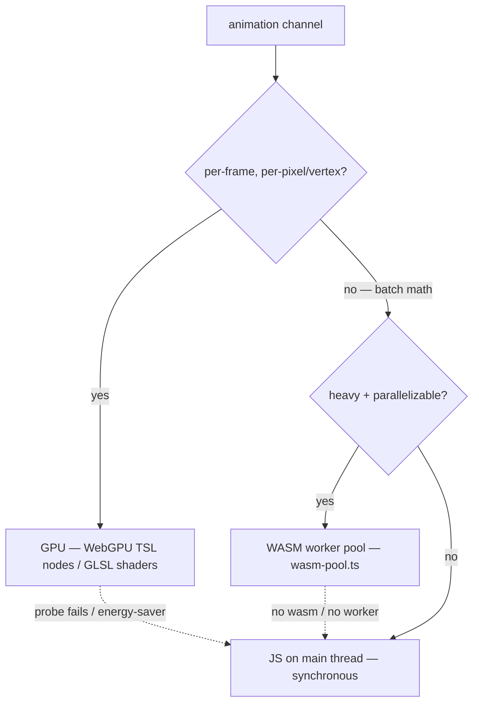
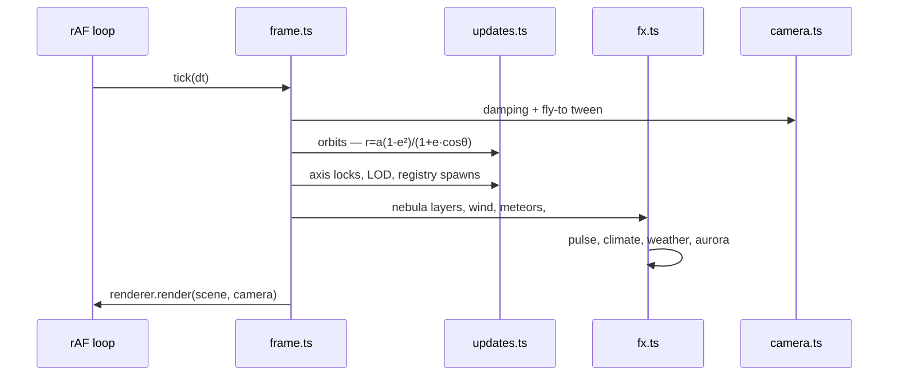

# Animations

Every animation system in luiskr.com V3 — what moves, who computes it,
and where the math lives. The physics-heavy sims (orbits, differential
rotation, solar wind, pulsation, climate cycles, fly-to easing) have
their own deep-dive folder: [physics-simulations/](physics-simulations/README.md).

## Compute placement policy

Per-frame work never `await`s. Every animation channel lands on exactly
one executor, chosen by where the data lives:

- **GPU first on desktop**: WebGPU node materials (three.js TSL) with a
  WebGL2/GLSL fallback, then a CSS/2D fallback when `webglContext`
  probing fails entirely (`?debug=webGLMode:fallback` forces this).
- **WASM workers for batch CPU**: spiral-fills, layout, scroll math,
  image decode and media hashing dispatch through
  `core/utils/wasm/wasm-pool.ts`; every entry point carries a JS
  fallback so threads/WASM absence never breaks a frame.
- **JS on the main thread** only for per-node transforms a GPU can't
  see (scene-graph pivots, DOM tweens) — all cheap O(bodies) math.

## Star Field (`experiments/star-field`)

The whole scene is one animation loop — `engine/frame.ts` ticks camera,
orbits, fx, LOD and registry spawns each frame. Full physics detail is
in [physics-simulations](physics-simulations/README.md); the channel
inventory:

| Channel                    | Executor            | Source                                 |
| -------------------------- | ------------------- | -------------------------------------- |
| Orbital motion             | JS scene graph      | `frame.ts` — conic `r(θ)` per body     |
| Orbital inclination        | JS (static tilt)    | `def.inc` on each pivot                |
| Axial spin + inertial lock | JS scene graph      | spinner node counter-rotates pivot Y   |
| Differential rotation      | JS/GPU              | galaxy rotor in `frame/updates.ts`     |
| Nebula drift + breathing   | GPU sprite rotation | `frame/fx.ts` — `node.nebula` layers   |
| Solar-wind swell           | JS → uniforms       | `SF_SOLAR_WIND` activity cycle         |
| Meteor impact flashes      | JS pooled sprites   | `SF_METEOR` pool in `fx.ts`            |
| Stellar pulsation          | JS scale/glow       | `def.pulse` — radius oscillation       |
| Climate cycle              | JS → material       | `def.cycle` slow albedo/ice modulation |
| Weather bands              | GPU rotation offset | `def.weather` cloud-layer drift        |
| Aurora ribbons             | GPU shimmer         | `def.aurora` polar glow layer          |
| Corona + flares            | GPU sprite pulses   | `def.flares`/`corona` seeded bursts    |
| Camera fly-to              | JS cubic tween      | `engine/fly.ts` — `easeInOutCubic`     |
| Registry body spawn/evict  | JS + worker fills   | `registry-body.ts` LRU cache           |
| Spiral-arm fills           | WASM worker         | `engine/fill-worker.ts` batch dispatch |
| Skybox / 139k star cloud   | GPU static points   | `star-cloud.ts` single draw call       |

## Earth Playground (`experiments/earth-playground`)

A WebGPU Earth + space backdrop driven by `earth/runtime/frame.ts`:

- **Planetary spin** — Earth mesh `rotation.y` advances by sidereal-rate
  dt each frame; the cloud shell counter-rotates at a slower differential
  so weather visibly shears past the surface.
- **Day/night terminator** — a shader uniform tracks the sun direction;
  the surface material blends day/night textures across a soft
  scattering limb — pure GPU, zero CPU per pixel.
- **Atmosphere shells** — fresnel-rim fresnel shells pulse with camera
  altitude so the blue halo swells as you approach.
- **Space backdrop parallax** — `space/` layers drift on pointer/scroll
  input for depth without a second render pass.

## Website UI (`website/`)

DOM/component animations — all CSS-transform driven (compositor
thread), honors `prefers-reduced-motion`:

- **Genie dialog** (`core/utils/motion/genie.ts`) — modal scales out of
  the control that opened it via `--genie-x/--genie-y` transform-origin;
  zooms back in on close.
- **DrawText** (`components/media/draw-text/`) — SVG stroke-dash
  handwriting reveal; segment timing is computed off-thread through the
  wasm-pool text-timing batch, then played as CSS transitions.
- **Scroll state** (`core/utils/motion/scroll-state.ts`) — parallax /
  reveal progress is sampled once per frame and written to CSS custom
  properties; heavy easing math goes through `wasm-scroll.ts`.
- **Skeletons** — shimmering `--skel-bg-*` gradient sweeps while real
  content streams in; pure CSS.
- **Carousel / mosaics** — layout springs computed by `wasm-layout.ts`
  batches, applied as transforms.

## CMS (`cms/`)

Editor micro-animations — section accordions, drag-reorder ghosts,
toast slides — all CSS transform/opacity, token-timed via
`ANIMATION_DURATIONS`; nothing animates layout properties.

## Reading deeper

- Physics sims with equations and stability notes:
  [physics-simulations/README.md](physics-simulations/README.md)
- Star-field architecture: [../architecture/star-field.md](../architecture/star-field.md)
- WASM pool contract: `core/utils/wasm/wasm-pool.ts` JSDoc
