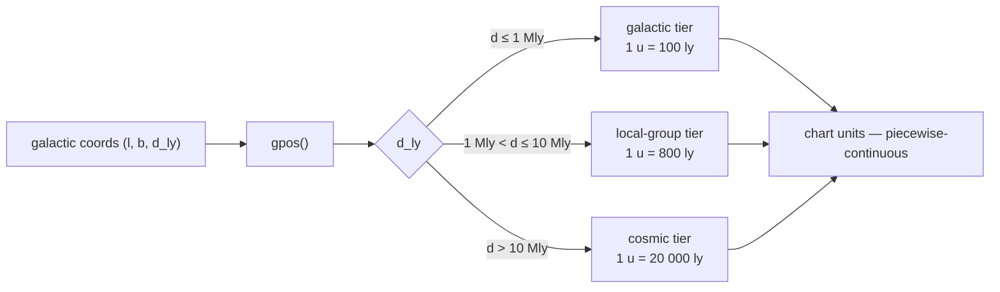
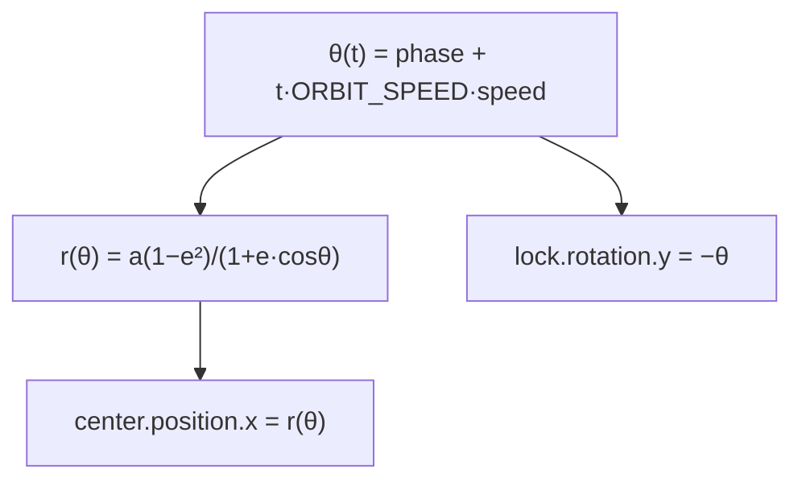
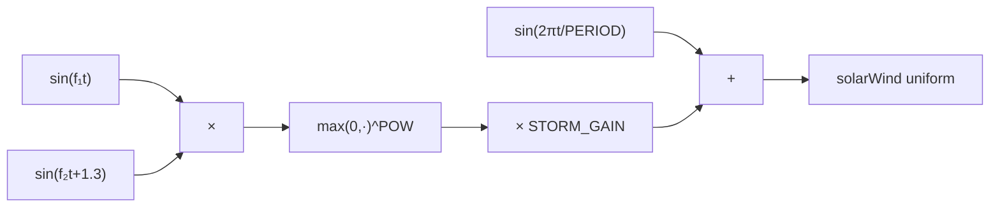
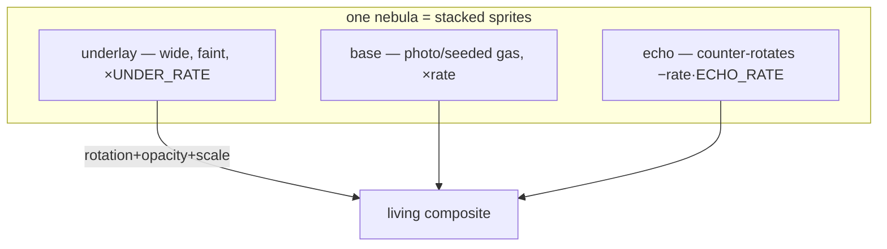
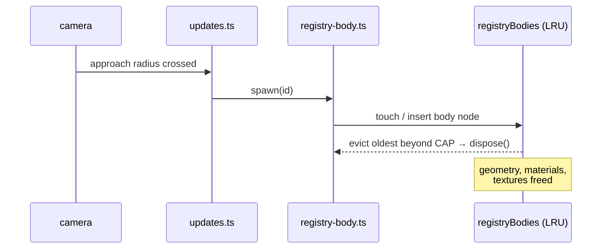

# Physics Simulations

Every physics simulation in the project — mostly the Star Field engine,
plus the spring/tween models used on the site — with the math each one
actually runs. All constants live in `core/tokens/starfield/params/*`;
the code below names the token that owns each number.

Parent index: [animations/README.md](../README.md).

## 1. Coordinate frames and distance compression

`engine/scale.ts` + `engine/catalog/geo.ts`.

Twenty orders of magnitude separate Neptune's orbit from the
observable-universe boundary, so no linear scale can draw the cosmos.
Distances compress in three continuous tiers — **directions stay
astronomically true, only radii compress**:



`sfChartDist(ly)` is piecewise-linear and **continuous at both breaks**
(1 Mly → 10 000 units from either side), so ratios stay honest inside a
tier. Solar-system bodies get an extra `shrinkSolar` factor so AU-scale
orbits fit inside a 1 unit = 100 ly chart.

## 2. Keplerian orbits

`engine/frame.ts` — the main per-node loop.

Each orbiting body owns a **pivot** at the parent's center; the body
sits `orbit` units along the pivot's local +X.

```
pivot.rotation.y(t) = phase + t · ORBIT_SPEED · speed
```

- `phase` seeds the mean anomaly so siblings never start in a line.
- `speed` ranks by real period (TRAPPIST-1b..h span 2.6 → 0.35).
- `inc` tilts the whole pivot — the orbital plane, not the body.

### Eccentricity — the conic equation

Uniform angular sweep (a stylized chart, not an N-body integrator), but
the radial distance follows the true polar conic:

```
r(θ) = a (1 − e²) / (1 + e·cos θ),   θ = pivot.rotation.y − phase
```

Periapsis lands exactly on the authored `phase` direction; Halley-class
bodies visibly plunge and coast. The radius is written on `node.center`
(the orbit-offset carrier), **not** `node.mesh` — a mesh inside an
axis-lock group would have a position write rotated away.



### Inertial axis lock

A tilted body whose `spin` axis is parented under the orbit pivot would
precess once per year. `node.lock` counter-rotates:

```
lock.rotation.y = −pivot.rotation.y
```

so the axis stays inertially fixed — the terminator sweeps hemispheres
over the year, which is what makes `cycle` (§7) physically meaningful.

## 3. Axial spin + differential rotation

```
spinner.rotation.y(t) = t · SPIN_SPEED · spin
rotor.rotation.y(t)   = t · SPIN_SPEED · spin · ROTOR_DIFF   (galaxies)
```

`ROTOR_DIFF = 1.6` — a volumetric galaxy's inner-disc rotor out-spins
the rigid rim, the chart's honest read of a **flat rotation curve**
(inner material should lap the outer arms, not co-rotate rigidly like a
vinyl record).

## 4. Solar-wind activity signal

`engine/frame/fx.ts → solarWindAt(t)` — one shared signal every
wind-touched system reads.

```
W(t) = BASE + WAVE_AMP·(½ + ½·sin(2πt/WAVE_PERIOD))
     + STORM_GAIN·max(0, sin(f₁·t)·sin(f₂·t + 1.3))^STORM_POW
```

- `BASE + WAVE` — the ~11-year activity cycle compressed to scene
  seconds; a bounded 0.5–1 swell.
- Storm spike — the product of two **detuned** sines raised to a high
  power: rarely positive, briefly large → sharp gusts that ignite
  auroras and stretch flares. Detuning matters: equal frequencies would
  spike on a metronome; incommensurate ones cluster and skip
  irregularly, like real weather.



## 5. Stellar pulsation

`def.pulse = { period, amp }` — variable stars breathe:

```
k(t) = 1 + amp·sin(2πt/period)
mesh.scale = k
```

Betelgeuse runs `period 4.2, amp 0.06` — a slow, shallow semi-regular
swell, matching its real ~400-day variability.

## 6. Nebula layered gas dynamics

`engine/bodies/deep-sky.ts` + `frame/fx.ts` — nebulae are three stacked
sprites: photo/gas base, counter-rotating echo, wide underlay glow.
Each layer carries a rate derived from `lcg(seedFrom('id:nebula'))`, so
**every nebula churns at its own pace**:

```
layer.rotation(t) = layer.phase + t · layer.rate        (echo rate < 0)
layer.opacity(t)  = opBase·(1−W) + opBase·W·(½+½·sin(t·OP_FREQ + 3·phase))
sprite.scale(t)   = baseScale · (1 + BREATHE_AMP·sin(t·BREATHE_FREQ + phase))
```

Counter-rotation between layers reads as shear between gas at different
depths; the breathing term is the cloud swelling under pressure waves.



## 7. Climate cycles (Milankovitch-style)

`def.cycle = { period }` — glaciation tint:

- **Axis-locked bodies**: `k = ½ + ½·cos(pivot.rotation.y)` — warm
  peaks at northern summer exactly when the inertial axis tips the
  north pole sunward. The seasons _drive_ the ice.
- **Unlocked bodies**: free-running sine on `period`.

`material.color` lerps `warm → ice` — Earth's glaciation is the
canonical instance.

## 8. Meteor impact pooling

`node.meteorPool` — airless bodies take strikes:

- **Schedule**: next hit at `t + INTERVAL·(0.4 + 1.2·rand)` — Poisson-ish.
- **Placement**: uniform sphere sampling — `u = 2·rand−1` uniform in
  cos θ, `a = 2π·rand`, `r = √(1−u²)` → no pole clustering.
- **Light curve**: fast rise over the first 25 % of `LIFE`, then a slow
  decay — the real impact-fireball profile.
- Pooled sprites: fixed cap, slots recycle — zero allocation per hit.

## 9. Comet tails (sublimation window + streaming gas)

`SF_KINDS.COMET` bodies (Halley) render an irregular dark nucleus —
albedo ≈ 0.04, crumpled via `irregularGeometry` — wrapped in an
additive coma sprite plus a camera-facing gradient envelope sprite and
a **tapered gas cone** per tail, all parented to the `center` group.
Because `center` is only **translated** along +x by the conic radius
(pivot carries the angular sweep), local +x is anti-sunward by
construction at every orbital phase — the tails never need
orientation math.

- **Ion tail**: long, thin, blue-white, exactly anti-sunward (plasma
  entrained along the solar-wind field lines).
- **Dust tail**: shorter, wider, tilted `DUST_TILT` off the radius
  vector — grains lag the comet's orbital motion, fanning off the ion
  streak.
- **Gas layers**: each tail carries an open-ended `CylinderGeometry`
  cone (narrow root on the nucleus, wide `GAS_TIP` mouth at the far
  end) skinned with a doubly-tileable filament field (`gasFor` —
  sine-wandering wisps with integer cycle counts so `wrapS`/`wrapT =
RepeatWrapping` tile around the circumference AND along the axis).
  A per-vertex color ramp `b = min(1, 3.5t)·(1−t)^1.3` fades the tip
  to black — under additive blending the tail dissolves into space
  with no hard rim, and the true 3D volume never shows a billboard
  rectangle from any camera angle. updateFx rescales `(len, w, w)`
  from the live radius, scrolls `map.offset.y` to stream filaments
  anti-sunward (`−t·GAS_FLOW`), swirls `rotation.x` ±`WOBBLE_AMP`
  (axial spin around the tail's own axis), and flickers opacity on a
  per-comet seeded rate — the tail churns like plasma/dust being
  blown off, not a painted streak.
- **Activity factor**: sublimation ignites only inside a periapsis
  window — `rCut = rMin + span·ACTIVE_FRAC`, then
  `f = clamp((rCut − r)/(rCut − rMin), 0, 1)^GAMMA` where
  `r = center.position.x` is the live conic radius (≈1/r² flux
  behavior). Below `TAIL_OFF` the tail sprites unmount entirely
  (`visible = false`) — a comet flying home from apoapsis shows a dark
  nucleus under a `COMA_FLOOR`-thin coma, never a phantom streak.

## 10. Cryovolcanic plumes

`def.plumes` (Enceladus `polar`, Io scattered) — per vent a **tapered
cone jet** (`CylinderGeometry` with a vertical alpha-ramp texture, so
the column reads as a 3D jet from every azimuth) plus a `puff` cycling
`dir·(radius + cyc·height)` with `opacity ∝ 4·cyc·(1−cyc)` (rises
bright, fades at altitude) and `width ∝ 1 + 1.6·cyc` (expands as it
climbs). Vent directions sample the south-polar band (`|y| > POLAR_LAT`)
or the uniform sphere. **Sun gating**: each vent's `sunDir` slot is
rewritten per frame by the shared `updateDayNight` vector;
`dot(ventDir, sunDirLocal)` smoothsteps between `SUN_LO`/`SUN_HI` —
night-side vents drop to `DARK_FLOOR` so geysers read on the lit limb
the way the Enceladus backscatter images show them. The group is a
`detail` member — plumes switch off at LOD distance — and a mesh
child, so vents co-rotate with their terrain.

## 11. Corona + limb flares

- **Corona**: slow in-plane UV rotation `phase + t·rate`; opacity
  shimmer `0.55 + 0.2·sin(6·rate·t + phase)` scaled by `0.7 + 0.5·wind`.
- **Flares**: `k = max(0, sin(t·rate + phase))⁴ · (0.25 + wind)` —
  sin⁴ makes bright narrow pulses; scale stretches
  `MIN_SCALE + MAX_STRETCH·k`, so storms throw prominences into space.

## 12. Fly-to camera tween

`engine/fly.ts` — selection glides the camera over `FLY_MS` (2.6 s):

```
easeInOutCubic(p) = 4p³                p < 0.5
                  = 1 − (−2p + 2)³/2   p ≥ 0.5
```

The destination re-resolves the body's **live** world position every
frame (`track()`), so a moving rider-mounted anchor can't strand the
camera on a stale spot. Any drag/wheel input cancels instantly — the
tween never fights the user.

## 13. Floating origin + LOD

- `followSelected` pins the followed anchor at the origin each frame,
  so fly-to spans only the local gap — positions never carry 40 000-unit
  magnitudes into float32 transforms.
- `updateLod` swaps high-detail meshes in/out by camera distance;
  `checkApproach` prefetches dossier JSON + near-field detail before
  the body is visited — lazy load ahead of need.
- **Per-detail reach override** — detail objects carrying
  `userData[SF_USER_DETAIL_R]` (the LEO swarm holder, catalogued
  orbiters like the ISS) gate on an absolute camera distance instead of
  the generic `PAD + max(radius, orbit)·SCALE` reach. Without it a
  host's heliocentric `orbit` (Earth: 44 units → ~570-unit reach) would
  reveal its near-field shell from interplanetary range; the override
  keeps LEO glints visible only inside lunar range (~7 units).
- `registryBodies` is an LRU map: registry stars spawn real meshes on
  approach/selection and evict the least-recently-touched beyond the
  cap — 139 k catalogued objects can't all exist at once.



## 12. Star-cloud fill (WASM worker)

`engine/star-cloud.ts` + `fill-worker.ts` — the 139 563-object HYG
binary catalog is a **single Points draw call**. Attribute fills
(position/color/size) dispatch through `wasm-pool` when threads+WASM
exist, with a synchronous JS fill as the fallback — batch work only,
never per-frame.

## 13. Website springs & tweens

- **Genie** (`core/utils/motion/genie.ts`) — transform-origin scale
  tween timed by `ANIMATION_DURATIONS`; compositor-only (`transform`),
  skipped entirely under `prefers-reduced-motion`.
- **Scroll easing** (`wasm-scroll.ts`) — parallax progress through
  spring smoothing, batched in WASM where available.
- **DrawText** — stroke-dashoffset reveal; the dash schedule is a
  wasm-pool text-timing batch.

## Where each sim executes

| Sim                        | Runs on                | Why                              |
| -------------------------- | ---------------------- | -------------------------------- |
| Orbits, locks, tweens      | Main-thread JS         | scene-graph transforms, O(nodes) |
| Wind/pulse/climate/fx      | Main-thread JS         | scalar math → uniforms/colors    |
| Weather, aurora, day/night | GPU shader uniforms    | per-pixel                        |
| Nebula swirl               | GPU sprite UV rotation | per-fragment                     |
| Star-cloud / fills         | WASM worker threads    | batch buffer math                |
| Spiral fills               | WASM worker threads    | batch point generation           |
