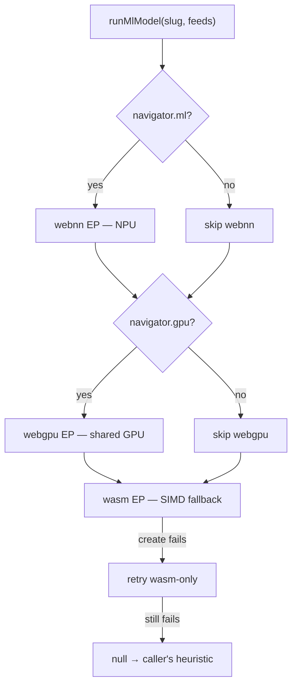
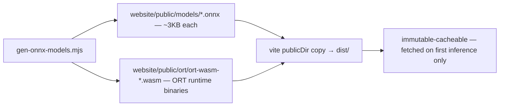

# ML Acceleration — ONNX Runtime Web, WebNN & WASM

The site's machine-learning layer. Every model is a **tiny ONNX graph
generated at build time** (`shared/scripts/build/gen-onnx-models.mjs`)
and executed lazily through ONNX Runtime Web — never on the critical
path, always with a deterministic fallback.

## Execution-provider ladder

`core/utils/ml/ort-engine.ts` owns the runtime:

- **Lazy by contract** — `import('onnxruntime-web/webgpu')` runs on the
  first inference call, so the ~1MB runtime bundle and the wasm
  binaries in `/ort/` never touch TTI/LCP.
- **Sessions cache by slug** — `/models/<slug>.onnx` is fetched and
  compiled once per page lifetime; concurrent callers share the same
  promise.
- **EP probing, not hoping** — `webnn` is requested only when
  `navigator.ml` exists, `webgpu` only when `navigator.gpu` exists. A
  rejected accelerated session retries wasm-only before returning null.
- **Every failure → null** — callers keep their exact pre-ML heuristic,
  so a missing model, absent runtime, or dead driver can never break a
  feature.

## The models

| Model          | Input                           | Output                  | Consumer                                |
| -------------- | ------------------------------- | ----------------------- | --------------------------------------- |
| `intent`       | `[hoverNorm, speedNorm, bias]`  | `sigmoid → P(navigate)` | `npu-predict` prefetch scorer           |
| `frametime`    | `[5-frame window, quality]`     | predicted frame ms/100  | star-field + earth adaptive pixel-ratio |
| `superres-2x`  | `[1,3,H,W]` RGBA planar         | `[1,3,2H,2W]`           | media-figure ladder end                 |
| `diagram-cost` | `[nodes, edges, nesting, self]` | predicted render ms     | docs mermaid scheduling                 |

### intent — navigation prefetch scorer

`core/utils/gpu/npu-predict.ts` ran a hand-tuned linear blend
(`base + hover·w + (1−speed)·w`) for years. The `intent` model lifts
those same weights into logit space (`sigmoid(2.2·hover − 1.6·speed −
0.6)`) so the NPU tier now executes a real graph — on an actual NPU
when the machine has one — while every lower tier computes a
comparable score. A null inference falls back to the original blend.

### frametime — three.js adaptive quality

`core/utils/ml/frame-time.ts` keeps a zero-allocation ring of the last
five frame times (normalized /100ms) plus the current quality level.
Every 30 frames it fires one inference — **never awaited inside the
rAF tick** — and steps the pixel-ratio multiplier:

- predicted > 17ms → quality −0.15 (floor 0.5)
- predicted < 12ms → quality +0.05 (ceiling 1.0)

Star-field (`tickStar`) and earth (`tickEarth`) record each frame and
re-apply `setPixelRatio` only on a transition — the DLSS-style contract
of "render smaller when the model predicts overrun, recover when it
sees headroom". This is the honest version of console-grade quality:
the browser can't fake PS5 silicon, but prediction-driven resolution
scaling is the same technique consoles use for dynamic resolution.

### superres-2x — low-quality media enhancement

When the manifest's quality ladder ends on a rung that still
under-resolves the display box (`naturalWidth < displayWidth`), the
figure runs the Conv+DepthToSpace model — 3 channels × 4 subpixel
phases of separable Catmull-Rom bicubic taps — producing a 2×
`ImageBitmap` that re-uploads into the same GPU texture via
`processBitmapGPU`. Same painted box, sharper bitmap, no layout shift,
no blink. Inputs cap at 512² px (the readback marshals on the main
thread); larger media already has the quality it needs.

### diagram-cost — mermaid scheduling

The docs viewer's mermaid blocks render through `rust/diagram` (wasm).
Before each block renders, four cheap regex counts (nodes, edges,
subgraph nesting, self-messages) feed the `diagram-cost` model; a
prediction over 24ms yields one task turn first, so a large graph can't
long-task the docs view between blocks. Small diagrams render
immediately as before.

## Artifacts & delivery

- `gen-onnx-models.mjs` serializes the graphs by hand (minimal
  protobuf writer — no external model toolchain, no network) and is
  invoked by `build-targets.mjs` **before** build 0 copies `public/`.
- ORT wasm binaries are copied from `node_modules/onnxruntime-web/dist`
  — the asyncify build for jsep EPs (WebNN/WebGPU) plus the plain
  simd-threaded build for the wasm EP. Committed artifacts, same
  convention as `/wasm/*/`.
- `ort.env.wasm.wasmPaths = '/ort/'` — ORT fetches the exact binary its
  chosen EP needs; untouched paths are never downloaded.
- `env.wasm.numThreads = 1` — the models are sub-millisecond; the proxy
  worker isn't worth a thread slot.

## Failure contract

Every public surface resolves `null`/`quality-hold`/heuristic on any
failure — import, session create (both EP attempts), `session.run`,
bad output shape. The ML layer can only ever _improve_ on the baseline
behavior it replaced; it can never regress it. Jest routes
`onnxruntime-web` through `shared/tests/__mocks__/onnxruntime-web.js`
so suites drive every arm deterministically.
