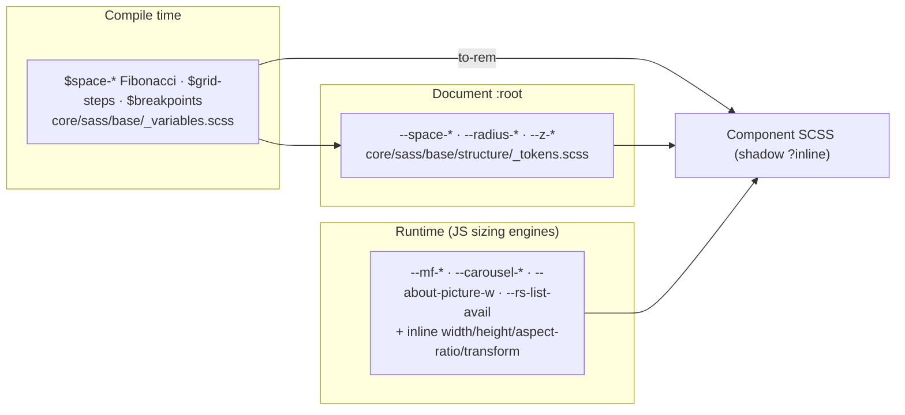

# Sizing system

The complete sizing rulebook: who owns each box, where the numbers come
from, and the contract every component follows. Fitting behavior lives in
[fitting.md](fitting.md); cascade/override rules live in
[style-precedence.md](style-precedence.md).

## The three sizing channels

Every rendered box is sized by exactly one of three channels — mixing
channels inside one property is the bug the rules exist to prevent.

| Channel        | Owner                    | Mechanism                                             | Used for                                                                     |
| -------------- | ------------------------ | ----------------------------------------------------- | ---------------------------------------------------------------------------- |
| Static SCSS    | Stylesheet               | `var(--*)` tokens, `to-rem($space-*)` in base only    | Fixed geometry: gaps, radii, control squares, breakpoints                    |
| Published vars | JS → CSS custom property | `el.style.setProperty('--x', px)` on a host/container | Geometry measured at runtime: strip heights, list avail-height, genie origin |
| Inline styles  | JS → `el.style.*`        | `width`, `height`, `transform`, `aspectRatio`, `left` | Per-node geometry: mosaic tiles, deck poses, expand-modal media box          |

Rules:

- **CSS never reads layout** — a stylesheet may express ratios
  (`aspect-ratio`), caps (`max-height`), and percentages, but pixel
  answers to "how wide is this" always come from JS.
- **JS never writes cosmetics** — runtime writes are restricted to
  geometry (`width/height/left/top/transform/aspectRatio/zIndex/opacity/
visibility`) and `setProperty` on geometry vars. Colors, radii, fonts,
  and shadows are stylesheet-owned, always.
- **`$` vars never appear in component SCSS** — compile-time constants
  are legal only in `core/sass/base/`; components consume `var(--*)`.
- **`to-rem()` everywhere in base** — no `px` literals except the
  documented exceptions (`background-size: 200% 100%` shimmer lanes,
  `grid-template-rows: 0fr/1fr` accordion folds, media-query ranges).

## Token scales

All scales are single-sourced — each has one declaration site that every
consumer (SCSS, TS, WASM) reads.

| Scale                                   | Source                                                            | Consumed by                                                                    |
| --------------------------------------- | ----------------------------------------------------------------- | ------------------------------------------------------------------------------ |
| Fibonacci spacing `$space-*`            | `core/sass/base/_variables.scss`                                  | `to-rem()` in base; `var(--space-*)` at runtime; `core/tokens/layout/space.ts` |
| Grid steps `$grid-steps`                | `_variables.scss` (`grid-steps` map)                              | `%MAXAREA` padding, `#grid-overlay` columns                                    |
| Breakpoints `$layout-*` / `BREAKPOINTS` | `_variables.scss` / `core/tokens/layout/breakpoints.ts`           | `layout-*` mixins, JS `BREAKPOINTS[n]`                                         |
| Radii `$radius-*`                       | `_variables.scss`                                                 | `var(--radius-*)`                                                              |
| z-index `$z-*`                          | `_variables.scss` (`z-indexes` map)                               | `var(--z-*)` — sole layering table                                             |
| Fonts `$font-*` / `%TTL_*`/`%TXT_*`     | `_variables.scss` / `_placeholders.scss`                          | `.ttl-*` utility classes, component `@extend`                                  |
| Media dimensions                        | `core/tokens/media/dimensions.ts`                                 | All JS media math (TS mirror of SCSS)                                          |
| Carousel geometry                       | `core/tokens/motion/carousel.ts` (`CAROUSEL`)                     | `custom-carousel` sizing/projection                                            |
| Masonry ratios                          | `core/tokens/layout/masonry.ts` (`LAYOUT`, `MEDIA_MOSAIC`)        | HomeMosaic + MediaMosaic packers                                               |
| Deck geometry                           | `core/tokens/motion/mentions-deck.ts` (`MENTIONS_DECK_LAYOUT`)    | MentionsDeck measure/poses                                                     |
| Card-stack tiers                        | `core/tokens/motion/card-stack.ts` (`CARD_STACK` fan/stack tiers) | CardStack coverflow layout + peek fit                                          |
| `sizes` attributes                      | `core/tokens/media/sizes.ts` (`IMAGE_SIZES`)                      | Per-surface responsive `sizes` strings                                         |
| Search list vars                        | `core/tokens/css/route-search.ts` (`RS_CSS_PROPS`)                | `--rs-list-*` var names for the list clamp                                     |

### Spacing scale (Fibonacci)

`0 1 2 3 5 8 13 21 34 55 89 144 233 377 610 987` — token names
`--space-none|hairline|pixel|2xs|xs|sm|md|lg|xl|2xl|3xl|4xl|5xl|6xl|7xl|8xl|9xl`.
Component chrome heights reuse the same steps: 34px controls, 55px card
chrome, 89px description indents, 144px title blocks and paddings, 233px
thumb bands and dialog boxes, 377px inputs, 610px dialog max-widths,
987px content caps.

### Grid steps (`%MAXAREA`)

`%MAXAREA` (`core/sass/base/_placeholders.scss`) is the content-gutter
contract: `width:100%; box-sizing:border-box;` plus horizontal padding
from the `$grid-steps` breakpoint map. Every full-bleed section host
extends it; `#grid-overlay` draws its columns from the **same map**, so
the debug overlay can never drift from the real gutters. Inside a
`%MAXAREA` host, children are full-width — further padding is opt-in per
component.

### Breakpoints

Two breakpoint families exist and are never interchanged:

- **Layout breakpoints** (`layout-*` mixins / `BREAKPOINTS`) — width
  rungs: `272 320 375 414 540 768 960 1024 1280 1360 1440 1560 1680
1920 2100 2560 3840`. Used for grid steps, vw ladders, JS mode
  switches (`1024` = mobile/tablet ceiling, `960` = side-by-side floor,
  `3840` = multi-fit floor, `768` = deck/mobile split).
- **Container breakpoints** (`container-*` mixins, `cqw` units) —
  element-query rungs used only inside components that already adopted
  container queries (`about` section); declared **after** the vw rules
  so cqw wins when both apply.

JS mirrors the same numbers through `BREAKPOINTS` — never a fresh literal.

## JS sizing engines

| Engine                  | File                                           | Job                                                                                                                                                                                                     |
| ----------------------- | ---------------------------------------------- | ------------------------------------------------------------------------------------------------------------------------------------------------------------------------------------------------------- |
| `wasm-layout.ts`        | `core/utils/wasm/`                             | Shared geometry: `calcColumnWidth`, `calcAspectScaled`, `calcMediaScale` (contain-fit, `≤1`), `calcMediaBox`, `calcResponsivePadding`, `calcGridGutter`, `pick` — WASM fast path, identical JS fallback |
| `sizing.ts`             | `website/components/carousel/custom-carousel/` | Strip decision + `--carousel-*` publication                                                                                                                                                             |
| `pack.ts` + `layout.ts` | `website/components/home/mosaic/`              | HomeMosaic masonry (feature spans, ratio ladder, lowest-column placement) + DOM application                                                                                                             |
| `pack.ts` + `layout.ts` | `website/components/media/mosaic/`             | MediaMosaic natural-size wall (quality ladder, pocket fit, skyline) + scheduling                                                                                                                        |
| `deck.ts`               | `website/components/home/cardstack/`           | Tier pick (`pickTier`), `measure`, `fitPeek`, `fitDeckToFront`, `applyPoses`                                                                                                                            |
| `deck.ts`               | `website/components/carousel/mentions-deck/`   | Card measure (fill-fit vs vw clamp) + per-card poses                                                                                                                                                    |
| `fit.ts`                | `website/components/media/draw-text/`          | Scale-down-only text fitting                                                                                                                                                                            |
| `titlefit.ts`           | `website/components/home/about/`               | Title width → `--about-picture-w`                                                                                                                                                                       |
| `RouteSearch.tsx`       | `website/components/search/`                   | `--rs-list-avail` (list avail-height publisher)                                                                                                                                                         |
| `dom.ts`                | `core/utils/`                                  | `flushLayout`, `viewportWidth/Height`, `remPx`, `nextFrame`, `afterLayout`, `observeResize` — the read/write discipline                                                                                 |

All engines follow the same frame discipline: **read inside one rAF (or
observer callback), write inside the next**, never interleave. Resize
entry points are `observeResize`/`ResizeObserver`, and work coalesces to
one pass per frame.

## Component sizing contracts

Each entry lists the exact sizing rules a component and its
sub-components follow. "Natural size" means the declared intrinsic
`size=[w,h]` (or the `GENERIC_DIMENSIONS` fallback when absent).

### `media-figure` — the shared media box

`core/sass/components/media/media-figure/` ·
`website/components/media/figure/sizeStep.ts`

`:host` is `display:block; width:100%; height:auto` by default
(stretch) plus `content-visibility:auto; contain-intrinsic-size:auto
60vh` so below-fold figures skip layout+paint until they approach.
Context classes then re-contract the box:

- **`.internal-extra-item`** (carousel slides + wall items) —
  `width:auto; content-visibility:visible; contain-intrinsic-size:none`
  via `:host-context` — the host shrinks to content (the placeholder
  drives the box) and opts out of skip-rendering because nav centering
  measures it with `getBoundingClientRect` — a skipped slide would
  report the 60vh fallback instead of its real box.
- **`.internal-extra-item.landscape`** — same fixed `--mf-h` strip
  height as every slide, plus a `--mf-max-w` width cap (declared only
  for landscape items) so a wide source renders full-height without
  flooding the strip.
- **`.media-mosaic-item`** (skyline wall tile) — `width:100%;
height:100%` and the same on `figure/.render-placeholder/
.render-media` — the packer **owns the box outright** (a shrunk
  pocket-fit can be narrower than any natural rung), so the figure
  fills the stamped tile instead of rendering at its intrinsic cap.
- **`.internal-main-item`** (project main cover) — `width:100%;
margin:auto`; the figure caps at `max-height:70dvh` and **every
  element** clamps `max-width:min(100%, var(--mf-natural-w), calc(100vw
− gap×2))` through `grid-steps` — a 4K source still pulls back
  inside the gutter. ≥768 the placeholder goes `width:auto;
max-height:min(70dvh, natural)` — an undersized file centers instead
  of stretching.
- **`.ztf-video`** (zoom-to-fill hero) — overrides the contain default:
  placeholder and figure clamp at `min(175dvh, 100vw − gap×2)` — a
  ≈2.5:1 cinematic bound so short ultrawide windows keep the frame
  instead of cropping to a panorama.

Height chain: `aspect-ratio` → intrinsic `height` → `max-height` caps,
whichever binds first. Inside a carousel the host publishes `--mf-h:
var(--carousel-media-height)` so every slide pins to the shared strip
height; unset, the fallback is `auto`. Render stamps
`--mf-natural-w/h` from the declared size; every box clamps at
`min(container, natural)` so a file never paints larger than its
source. `object-fit:cover` + `object-position:top center` is the crop
policy on every fixed box.

Sub-boxes (`.mf-*`): `mf-ph` (instant-paint placeholder),
`mf-media`/`mf-thumb`/`mf-high` (resolution ladder layers — thumb is
`filter:blur(12px); scale(1.05)` until `--high` fades in; mobile drops
the blur for an opacity dim because filter repaints every frame),
`mf-skel` (shimmer under all of them), `mf-expand` (hover affordance),
`mf-cap` (figcaption).

### `custom-carousel` — strip vs side-by-side

`core/sass/components/carousel/carousel.scss` ·
`website/components/carousel/custom-carousel/{sizing,apply}.ts`

- **Strip height** = the tallest item rendered into `hostW × (vh ×
MAX_HEIGHT_VH=70)` via `calcMediaBox` — never upscaled; JS publishes
  it as `--carousel-media-height` on the host and
  `--carousel-item-height` on the enclosing section once per pass.
- **Mobile anchors** — on mobile the strip isn't tallest-wins: a
  **mixed** carousel anchors to the shortest portrait (`hostW ×
minPortraitRatio`); an **all-landscape** one anchors to `hostW /
majorityRatio` (16:9·21:9·32:9 vote via `determineLandscapeRatio`).
  Both clamp to the tallest honest fit so the vw-anchored target never
  exceeds what the biggest item can render.
- **Unsized fallback** — no sized items at all → `hostW / RATIO_16_9`
  from the RO-cached width only (zero layout reads inside a dirty
  render task); a ~70dvh `--mf-h` placeholder holds the row until the
  first real measurement.
- **Slide box** = `height:var(--mf-h); width:auto` — `stripH × intrinsic
ratio`, floored at `min-width: min(MEDIA_MIN_WIDTH, naturalW)` so a
  file narrower than the floor keeps its natural width (never
  upscaled). **Landscape slides render uncapped** at full aspect width
  — an earlier cap made wide boxes squash into center slivers, so the
  projection mirrors "aspectW itself" as their honest width. Only the
  ≥3840 multi-fit path caps portrait slides at
  `min(aspectW, $space-8xl, naturalW)`.
- **Chrome per item** — `ITEM_PAD_768` (42px) horizontal padding +
  `ITEM_GAP_PX` gap on every slide; `ITEM_MARGIN_PX×2` side margins
  only ≥`ITEM_MARGIN_VW` (1024).
- **Mode precedence** — `_forceActive` pins the track below
  `MULTI_FIT_MIN_VW` (3840); ≤2 items go side-by-side when `vw ≥
SIDE_BY_SIDE_BREAKPOINT` (960) AND the projected total (slides +
  chrome) ≤ `hostW`; >2 items only side-by-side at ≥3840 under the
  same projection. Otherwise the drag track.
- **Unsized CMS rows** project with `GENERIC_DIMENSIONS` defaults
  (conservative portrait) so a missing `size` can't silently flip a
  real fit to scroll mode.
- **≤1024 cap** — `HALF_NATURAL` block halves every media box and the
  strip height.
- **Controls** — `.c-ctrl` 34px squares; `.c-hold` drag surface; track
  is `display:flex` with `will-change:transform`. Off-screen skip lives
  on the `media-figure` host instead (`content-visibility:auto` +
  `contain-intrinsic-size: auto 60vh` — slides opt out so the strip's
  measurement stays honest).

### `awards-carousel` (legacy deck)

`core/sass/components/carousel/awards-carousel/`

- Slide width is a **vw ladder**, never item-derived:
  `88vw → 82vw(768) → 78vw(1024) → 72vw(1440) → 66vw(2560)` — the
  slide stays just under one viewport so neighbours always peek.
- `.aw-c-cover` is `aspect-ratio:16/7; max-height:var(--cover-max-h,
80vh)` — the `80vh` fallback is the live cap (the var is a reserved
  JS hook; nothing publishes it today); `cover` crop inside.
- Track gaps step `xl → 2xl(768) → 3xl(1440)`; label/title/pager all
  `%MAXAREA`-aligned.
- Skeleton (`.aw-c-cover--skel` + `.aw-c-skel-*`) reserves the
  **identical** geometry — 16/7 + same max-height — so first paint
  occupies the final box (zero CLS).

### `mentions-deck`

`core/sass/components/carousel/mentions-deck.scss` ·
`website/components/carousel/mentions-deck/deck.ts`

- Deck height = card height × `DECK_H_RATIO`(1.24) — headroom so card
  shadows never clip.
- Card width = **fill-fit when the whole ring fits** inside the deck
  (`basis / (maxS·2·gapGrow + 1)` ≥ `CARD_W_MIN·FILL_FLOOR`), else the
  vw clamp `deck × CARD_W_VW`(0.25) into `[CARD_W_MIN 270, CARD_W_MAX
312]`; decks under 768 use the mobile pair (`CARD_W_VW_MOBILE 0.72`,
  floor 240) so a sliver of each neighbour peeks.
- Card height = width × `CARD_H_RATIO`(0.64); step = width ×
  `(1+GAP_RATIO)`; anchor = `basis × 0.5`.
- Fade lane = `w × FADE_FRAC`(0.5) on wide decks, 0 on mobile (peek
  layout, binary clip); the deck's `mask-image` lane is sized to the
  same span so a card is never visibly cut.
- Sizing is published once per `measure()` as inline
  `width/height/left`; per-frame writes are transform/opacity/z only.

### `home-mosaic` — the featured masonry wall

`core/sass/components/home/mosaic/` ·
`website/components/home/mosaic/pack.ts`

- Host extends `%MAXAREA`; columns = `calcColumnWidth(hostW, cols,
gutter)`; gutter = `LAYOUT.GAP`(16).
- **Featured span** — items flagged featured span two columns at
  `FEAT_MULT`(0.48) height ratio when the wall is wide enough.
- **Tile height** = `columnW × COMP_MULTS[i % 5]` — the compact
  multipliers `[0.56, 0.58, 0.54, 0.57, 0.55]` cycle per column so the
  wall stays dense; heights are **card-box** heights (media + chrome).
- **Card height** = `imageH + bottomH` — the media region gets the
  ladder height, and the expanded-details block adds its **measured**
  px on top when open (`bottomHFor(i)` supplies the live DOM height).
  The wall **reflows** the cards below — expansion never overlays.
- **Placement** — lowest-column ("peak") algorithm; `centerOffset` adds
  half the unused trailing-column width so sparse walls sit centered
  instead of hugging the left edge.
- **JS owns tile geometry** — every tile gets absolute
  `transform:translate(x,y)` + `width/height`; SCSS owns surface,
  spacing, radius, overflow, and the reservation `--media-mosaic-height`
  before the first pack.
- Skeleton reserves the container height token so the wall doesn't
  jump when the pack lands.

### `card-stack`

`core/sass/components/home/card-stack/` ·
`website/components/home/cardstack/deck.ts`

- Deck sizing is **tier-selected** from `CARD_STACK` — one responsive
  coverflow tier per viewport band (`MIN_VW` rungs). Two shapes:
  - **Fan tiers** (landscape cards, ≥1280): front card = `CARD_SHARE`
    (0.52–0.56) of deck width at `CARD_H_RATIO` 9/16, capped at
    `HEIGHT_SHARE` (0.85–0.88) of deck height; neighbours fan out on
    `STEP/DEPTH/ROT_Y` multiples **of card width** — every pose number
    scales with the measured card, so the arc fills whatever deck the
    band gives it.
  - **Stack tiers** (portrait "entire card" piles, ≤1279 portrait):
    `CARD_SHARE` 0.94, `CARD_H_RATIO` 1.0–1.45 (info inside the card),
    deal/fan/park slots again in card-width multiples.
- `fitPeek` sizes the cover media inside the card's visible window —
  same natural-ceiling rule.
- Poses are inline `transform` (x/y/rot/scale) + opacity + z, published
  per gesture frame; card box changes only on measure.

### `about-section` (+ `about/titlefit`)

`core/sass/components/home/about/` ·
`website/components/home/about/titlefit.ts`

- Section is `%MAXAREA`; the portrait is a **square** (`aspect-ratio:
1/1`) whose width is **title-fitted**: JS measures the rendered
  `draw-text` title line and publishes `--about-picture-w`; SCSS takes
  `max(<token floor>, var(--about-picture-w, <floor>))` — `$space-5xl`
  (144px) by default, `$space-6xl` (233px) ≥540 — so the portrait grows
  to match the title on every locale and only ever outgrows the token
  floor. At ≥1280 the contract switches to the media track:
  `min(max(50%, var(--about-picture-w, 50%)), 100%)` — half-track floor,
  full-track ceiling so the portrait can't push over the intro text.
- First home component to adopt **container queries** (`container-*
mixins` + `cqw`); cqw rules are declared after the vw ladder so the
  element-relative size wins when the container is established.
- Re-measures on render, title `ResizeObserver`, and `document.fonts`
  readiness; `WeakMap` + microtask dedup so a render burst costs one
  layout read.

### `media-mosaic` — the natural-size wall

`core/sass/components/media/media-mosaic.scss` ·
`website/components/media/mosaic/pack.ts`

- Tiles keep **natural size** (intrinsic or divided by the quality
  ladder `/3` default, `/4` when still too wide, `/2` or undivided when
  too small for the expand trigger) — never upscaled, never stretched
  to fill.
- **Pocket shrink-fit** — when a pocket's free height is smaller than
  the tile's `mh`, the tile scales `fit = pocketH/mh` (≤1) so it sits
  flush instead of floating with dead space below.
- The project view's section wrapper pre-publishes
  `--media-mosaic-height` (a `estimateMosaicHeight` pack at the
  predicted width) so a deferred `<media-mosaic>` reserves its final
  box via `min-height` — no CLS when the real pack lands.
- At ≤1024 the component renders `<custom-carousel>` instead —
  configured identically to the project binder's own (`forceActive`
  forwards verbatim).
- Placement writes absolute `left/top/width/height` per tile
  (`transform:translate(x,y)`); `object-fit:contain` inside the tile.

### `media-expanded` + `expand-modal`

`core/sass/components/{media/media-expanded.scss,dialogs/expand-modal/}` ·
`website/components/media/expanded/mount.ts`

- The modal is the **no-reduction surface**: mount stamps the item with
  `width:<naturalW>px; aspect-ratio:naturalW/naturalH` — pinned to the
  file's real pixels from frame one; the thumb → full-res swap can
  never resize the box.
- `max-width:100%` on the item + `aspect-ratio` (not a fixed px height)
  so narrow viewports shrink the width and the height follows
  proportionally — a stamped `height` would distort.
- Content column is `min-height:100dvh; flex-direction:column;
align-items:safe center; padding: 3xl×xl → 5xl` at 1024 — the `safe`
  keyword is the overflow contract: a natural-width file wider than
  the column falls back to start alignment so its leading edge can't
  clip past the dialog's scroll reach.
- Oversized files **overflow into the dialog's own scroll** on both
  axes — reductions belong to the page grids; the modal always shows
  the file whole.
- Video variant swaps to `height:100dvh; justify-content:space-between`
  so the close bar sits below without scrolling.
- `object-fit:scale-down` inside the stamped box; `--genie-x/--genie-y`
  custom properties carry the transform origin for the warp.

### `draw-text` (+ `fit` attribute)

`core/sass/components/media/draw-text/` ·
`website/components/media/draw-text/fit.ts`

- Base size comes from the typography placeholders (`%TTL_*`, `%TXT_*`)
  — never a literal `font-size`.
- The `fit` attribute opts into the JS fitter: measure parent
  content-box width + the widest `nowrap` word span (UAX#14 breaks), then
  scale `font-size` and `letter-spacing` together **only when the word
  overflows** — it can shrink, never grow past the styled size.
- Three-phase flush per trigger: clear prior inline writes → read →
  write scaled values, all inside one rAF; refits fire on
  attribute/text changes, parent `ResizeObserver`, and
  `document.fonts.ready` for late webfont metrics.
- First-fit skips the redundant clear-write (no override to undo), and
  a `Set` dedupes simultaneous triggers into one pass per frame.

### Dialogs — `preferences-modal`, `search-modal`, `lang-dialog`

`core/sass/components/dialogs/{preferences/,search-modal}.scss`

- **PreferencesModal** — `pref-backdrop` is `100dvw × 100dvh` inside the
  fixed host; `pref-dialog` is `width:100%; max-width:610px
($space-8xl); max-height:88dvh` — the backdrop padding constrains it
  to the grid, the cap stops it stretching on wide viewports.
  `--genie-x/--genie-y` set the transform origin (50% fallback = plain
  center zoom). The theme slider canvas is `height:64px;
border-radius:32px` — a token pair sized as a pill track; close
  buttons are `$space-2xl` (34px) hit targets over full-bleed WebGL
  canvases.
- **LangDialog** — shares the pref shell; `.lang-dialog { max-width:
min(480px, 100%) }` — a narrower cap than pref since its content is
  flag rows (`height:44px`, split flags `width:33px`).
- **SearchModal** — `sm-panel` is `width:100%; max-width:987px
($space-9xl)` with `box-sizing:border-box` (mandatory — content-box
  would add its `2×xl` padding on top of the container gutter and push
  edge-to-edge on mobile). Its body raises the results cap via
  `--rs-list-max: min(70dvh, 987px)` — the modal sits at the viewport
  top so most of the page height is usable.
- All three scale **from their trigger point** — `transform-origin:
var(--genie-x, 50%) var(--genie-y, 50%)` — and inherit
  `--z-modal-*` layering; `::backdrop` carries the dim.

### `route-search` (nav search)

`core/sass/components/search/route-search.scss`

- Results list `max-height: min(var(--rs-list-max, min(40dvh, 610px)),
var(--rs-list-avail, 100dvh))` — the smaller of a host-set design cap
  and the JS-measured space remaining below the panel. Short windows
  show fewer rows instead of clipping mid-row; the list owns the only
  scroll (`overflow-y:auto; overscroll-behavior:contain`).
- Rows size to content (`padding: sm × md`), not a fixed height; the
  numbered index pills, prev/next, and close controls are `$space-2xl`
  (34px) hit targets; the submit magnifier is `$space-xl` (21px).
- `--rs-list-gap: $space-2xl` is a host-overridable var — the search
  modal raises the cap through the same var contract.

### `app-nav` (shell)

`core/sass/components/shell/app/_nav.scss` + `_controls.scss` +
`_overlays.scss`

- `.nav` extends `%MAXAREA` and is `position:fixed; top:--space-lg` —
  the nav aligns to the content gutter, not the viewport edge.
- Controls are **`--space-2xl` (34px) hit targets** — the chip pattern
  sizes `height:2xl; min-width:2xl` so a bare icon is a square and a
  revealed label pours into a pill (`width:0→auto` interpolates to the
  measured label width; `max-width` stays as the fallback driver).
- The active-link underline is `width:100%` under the text — the logo's
  plasma filament (`::after` 2px core + `::before` blurred halo) rides
  the same geometry.
- Links size to text (`%TTL_*` placeholders), never a fixed box.

### Feedback — `cookie-banner`, `site-toast`, `stats-hud`, skeletons

`core/sass/components/feedback/`

- **CookieBanner** — a fixed **full-width** bottom bar (`left/right:0`)
  whose inner row extends `%MAXAREA` (content aligns to the grid
  gutter); vertical padding steps `md → lg` at 768 and the row wraps
  (`flex-wrap`) when the copy + buttons can't share one line. The
  banner's host box stays 0 because the bar is `position:fixed`, so JS
  measures the bar's `offsetHeight` (ResizeObserver, re-armed every
  render) and publishes `--cookie-banner-h` on `documentElement`; the
  document sheet consumes it as `main { padding-bottom }` — clearance
  while visible, property removed entirely once answered so the page
  reclaims the space.
- **SiteToast** — desktop `max-width:400px` column docked bottom-right
  at `$space-xl` + `env(safe-area-inset-bottom)`; ≤768 spans
  edge-to-edge (`left/right: $space-sm`, `max-width:none`) so the
  dismiss target stays in thumb reach. Items size to content
  (`padding: md × lg`); entrance animates translate+opacity, never
  box geometry.
- **StatsHud** — fixed overlay bottom-right at **grid-step** offsets
  (`right: $gap-272; bottom: $space-2xl` — the HUD hugs the content
  gutter, not the viewport edge); ≤540 pins `left+right: $gap-272` and
  `flex-wrap`s into rows (segment separators come off — they misread
  at wrapped row ends).
- **Skeletons** — `%SKEL_DARK_SURFACE`/`%SKEL_GRID_OVERLAY` reserve the
  exact final geometry (16/7, aspect-box, card rows) so placeholder →
  content is zero-CLS.

### Internals (project view)

`core/sass/components/internals/` + `core/sass/components/media/`

- **internal-main figure** — `width:100%; max-height:70dvh` on the
  figure with `object-fit:cover` on the media; at ≥768 the placeholder
  switches to `width:auto` so a natural-width file that can't fill the
  column centers instead of stretching (the 70dvh cap lives on the
  figure inside the shadow root — the section itself never clips its
  own padding).
- **internal-extra items** — `width:auto` host so the tile keeps its
  own size; media still uses `object-fit:cover` — the honesty is
  enforced on the **box** (placeholder clamps at `--mf-natural-*`),
  never by contain. Inside the ≤1024 carousel they get the strip
  contract (`--mf-h` height + item margin math).
- **Descriptions** — prose capped at `987px`; paragraph indents are
  `89px`; an `internal-image` inside a paragraph **promotes** out of
  the text flow to a full-width figure so media never shrinks to
  column width.
- **Related list** — an **accordion**, not a grid: each row's grid
  track folds `1fr → 0fr` and unfolds the next, so the window is
  always exactly the open card — `min-height:0` on `-inner` is what
  lets the 0fr row collapse (grid children default to auto). The media
  column is `flex:0 0 140px; aspect-ratio:1/1` → `260px / 16:10` (768)
  → `320px` (1024); `:empty` skeleton rows reserve `140/163/200px`
  min-heights mirroring the loaded column. Media `object-fit:cover`
  with a right-edge `mask-image` dissolve into the info column.
- **internal-footer** — `%MAXAREA`, Fibonacci gaps, 34px controls.

### CMS surfaces

`cms/sass/cms/` — separate document, same token contract

- `cms/sass/cms/_tokens.scss` republishes `--space-*`, `--radius-*`,
  fonts, skeleton, z-index at `:host,:root` because the CMS shell does
  not import the public `_structure.scss`.
- `$cms-*` compile-time vars own CMS chrome colors/borders; layout
  uses the same `to-rem()` channel — editor grids are
  `minmax(160px,220px) 1fr auto` rows and `repeat(auto-fit,
minmax(200px/240px, 1fr))` card fields; the portfolio editor
  reserves `min-height:400px`; login/dashboard shells are
  `min-height:100vh`.
- Editors render inside shadow roots with the same `?inline` SCSS
  contract; `innerHTML:` props on textareas are value bindings, not
  templates.

## Normative sizing rules

1. **Never upscale media** — every media box clamps at natural size
   (`--mf-natural-*`, `calcMediaScale ≤ 1`, `/2` ladder, `scale-down`).
   A too-big container leaves whitespace; it never enlarges pixels.
2. **Never stretch media** — box is computed `width = height ×
aspect` (or `aspect-ratio` property); `object-fit` only decides how
   the file crops inside an already-honest box.
3. **Token-only dimensions** — `to-rem($space-*)`/`var(--space-*)`,
   `var(--radius-*)`, `var(--z-*)`, `BREAKPOINTS[n]`. Magic numbers are
   governance failures.
4. **Breakpoints from the shared maps** — component media queries use
   `layout-*`/`container-*` mixins; JS uses `BREAKPOINTS`/`CAROUSEL`/
   `MENTIONS_DECK_LAYOUT` thresholds — never a literal pixel.
5. **Skeletons reserve final geometry** — every shimmer occupies the
   box the content will fill (aspect + cap), so content swap is
   zero-CLS.
6. **JS publishes, CSS consumes** — runtime-measured values travel as
   custom properties on the nearest host (`--carousel-*`,
   `--about-picture-w`, `--rs-list-avail`, `--cover-max-h`,
   `--genie-*`, `--cookie-banner-h`); the stylesheet stays declarative.
7. **≤1024 halves natural media** — the `HALF_NATURAL` contract: on
   mobile/tablet, media boxes render at ≤ half natural dimensions
   (`HALF_NATURAL_SCALE`) — bandwidth and layout both respect the
   smaller canvas.
8. **Overflow policy per surface** — grids/strips crop (`cover`), walls
   show whole files (`contain`), the expand modal scrolls (`scale-down`
   - dialog overflow), toasts/banners grow (`max-height` animation).
9. **Fixed chrome, fluid content** — control squares, card chrome,
   indents, and paddings are token-fixed; media/prose areas flex inside
   them.
10. **One measurement, one write** — ResizeObserver → measure → publish;
    never measure inside the write pass, never write inside the read
    pass.
