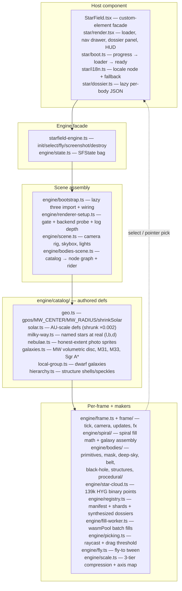
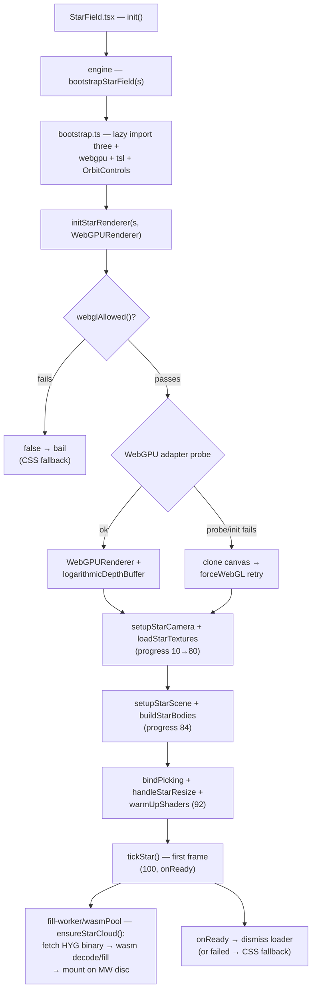
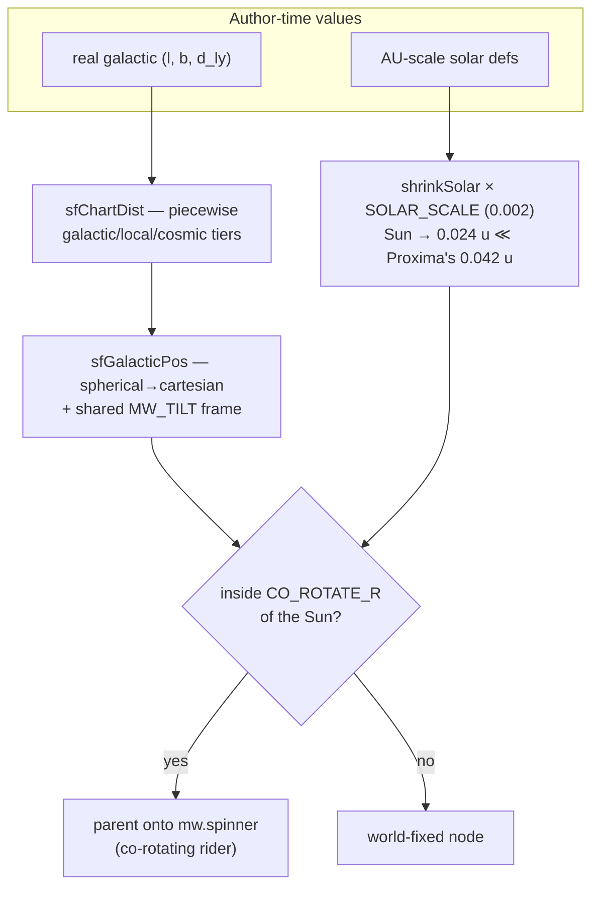
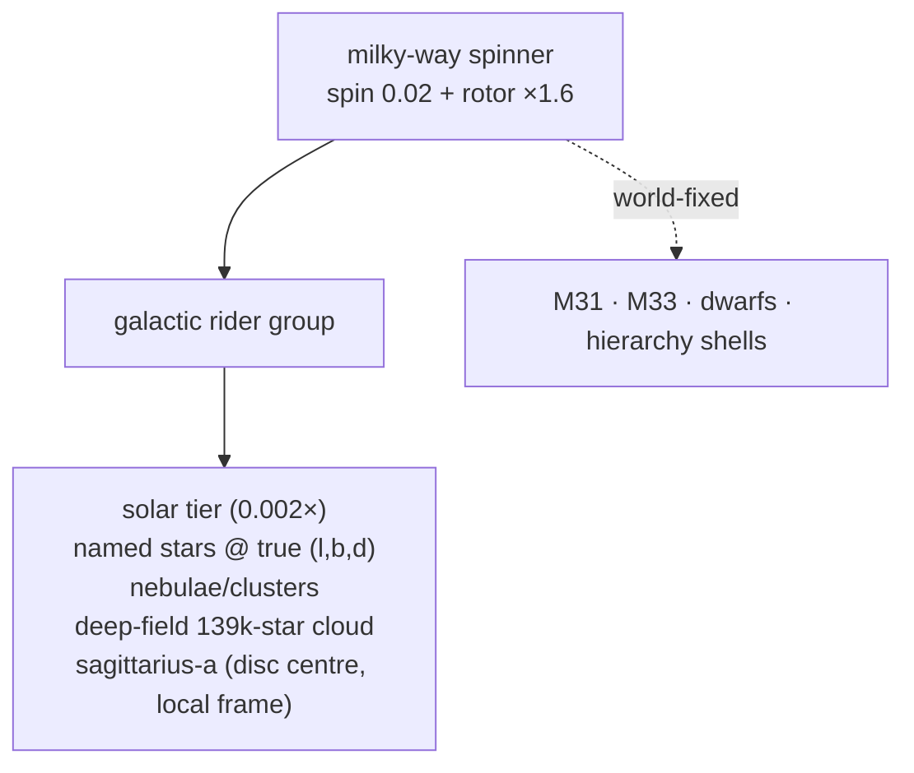
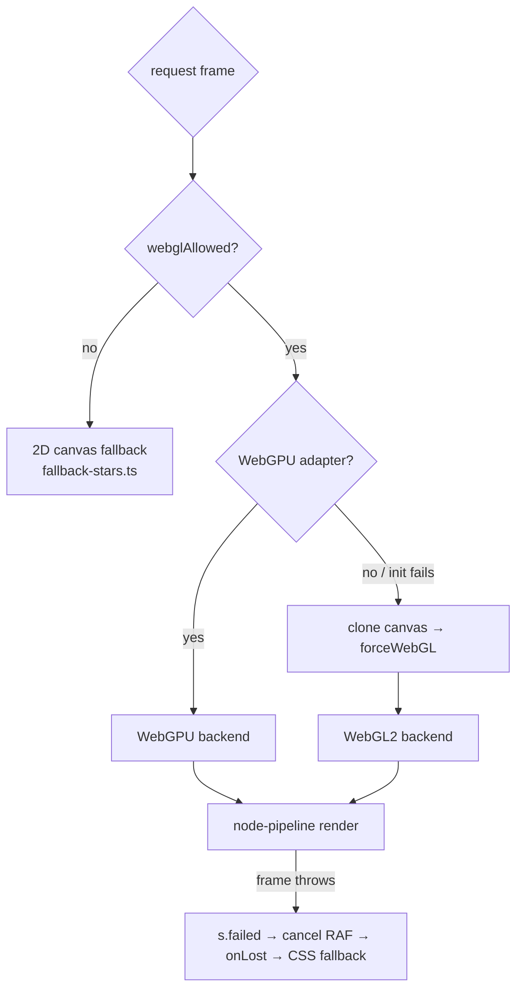
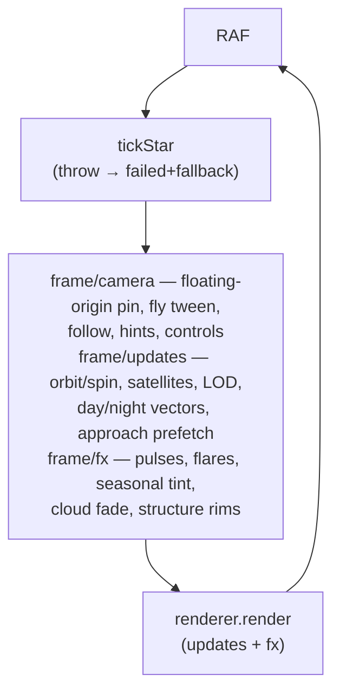
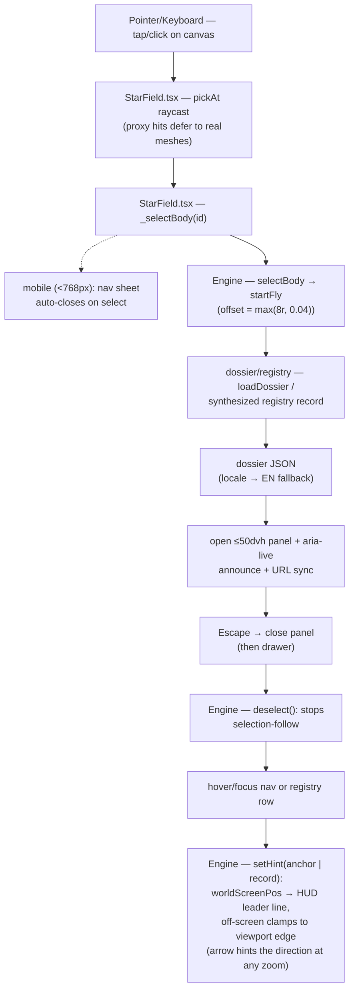
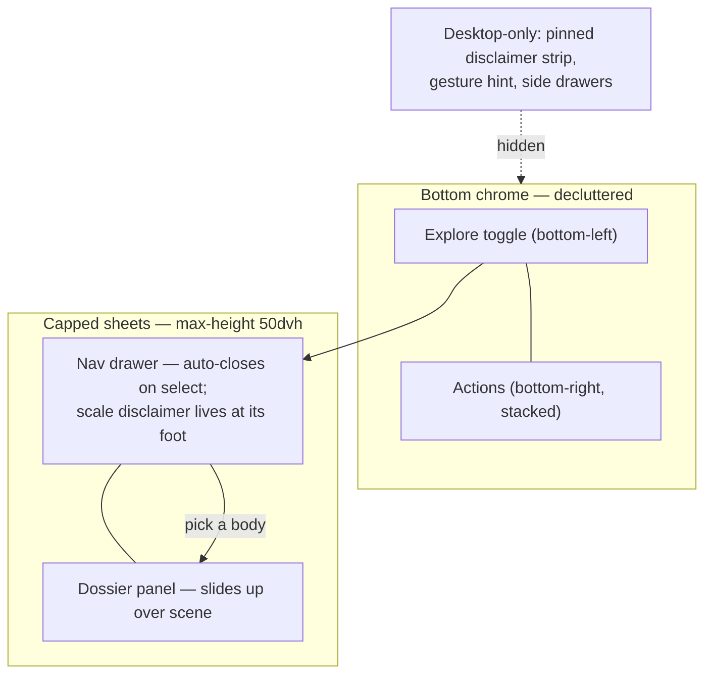

# Star Field (experiments/star-field)

A WebGPU-first space-exploration scene — the Solar System plus notable
Milky Way, Local-Group and cosmic-hierarchy objects (112 catalog bodies)
— rendered as an orbiting chart with raycast selection, camera fly-to,
a searchable 139k-record deep-field registry, lazy per-body dossiers and
PNG screenshot download. Route: `/star-field-experiment` (canonical)
plus a localized slug per supported locale; listed in the hamburger menu.

The chart's north star is **honest geometry**: every named object sits
at its real galactic `(l, b, distance)` through `gpos()`; nothing is
clustered for readability. Sizes compress in three documented distance
tiers, the Solar System is a point-scale diagram inside the star field,
and the whole galactic frame co-rotates so the Sun orbits the galactic
centre as part of the disc — never a stationary exhibit.

## Module map

| File / folder                                | Role                                                                                 |
| -------------------------------------------- | ------------------------------------------------------------------------------------ |
| `StarField.tsx`                              | Custom element facade — mounts canvas, owns loader/drawer/panel, keydown             |
| `starfield-engine.ts`                        | `StarFieldEngine` — owns `SFState`, exposes init/select/fly/screenshot               |
| `star/boot.ts`                               | Component↔engine lifecycle: progress → loader, ready → dismiss                       |
| `star/render.tsx`                            | View JSX — loader overlay, CSS fallback, nav drawer, dossier panel, HUD              |
| `star/i18n.ts`                               | `pages/star-field` locale node via SWR + English fallback                            |
| `star/dossier.ts`                            | Lazy dossier JSON load — shared in-flight/resolved cache, EN fallback                |
| `engine/bootstrap.ts`                        | Lazy three import, TSL dep injection, texture load, scene assembly                   |
| `engine/renderer-setup.ts`                   | `webglAllowed()` gate, WebGPU probe, canvas-clone retry, logarithmic depth           |
| `engine/scene.ts` · `engine/bodies-scene.ts` | Scene/camera/skybox/controls · catalog→node graph + galactic rider                   |
| `engine/catalog/`                            | Split defs: `geo` `solar` `milky-way` `nebulae` `galaxies` `local-group` `hierarchy` |
| `engine/scale.ts`                            | Three-tier distance compression + `(l,b,d)`→chart axis map                           |
| `engine/registry.ts`                         | 139k deep-field registry — manifest, sharded fetch, record dossiers                  |
| `engine/spiral/` · `engine/star-cloud.ts`    | Spiral fill/galaxy assembly · real-data 139k-star binary cloud                       |
| `engine/bodies/`                             | `primitives` `mask` `deep-sky` `belt` `black-hole` `structures` `procedural/`        |
| `engine/frame/` + `engine/frame.ts`          | RAF orchestrator — camera, updates, fx, shared armed-state                           |
| `engine/fly.ts` · `engine/picking.ts`        | Camera tween · pointer raycast (click-vs-drag threshold)                             |
| `engine/fill-worker.ts`                      | wasmPool dispatcher — index-partitioned fills with JS fallback                       |
| `engine/screenshot.ts`                       | `toDataURL` → `toBlob` PNG download                                                  |
| `engine/state.ts` · `engine/types.ts`        | State factory · type-only declarations (`SFState`, `SFBodyDef`, `SFNodeDeps`)        |
| `engine/fallback-stars.ts`                   | 2D-canvas starfield for the CSS fallback surface                                     |
| `star-field.scss` + `star-field/_*.scss`     | View stylesheet (loader, HUD, drawer, panel, mobile, fallback, themes)               |

## Boot sequence

`StarFieldEngine.init()` → `bootstrapStarField(s)` — every async
checkpoint re-checks `s.disposed` so a mid-boot `destroy()` can never
half-attach listeners, and `onReady` fires exactly once (success or
bail) so the loader can never stick.

## Scale & coordinate model

The chart is a multi-scale diagram — 20 orders of magnitude separate
Neptune's orbit from the observable universe, so distance compresses in
three tiers while **every direction stays astronomically true**:

| Tier        | Range    | Scale         | Contents                                         |
| ----------- | -------- | ------------- | ------------------------------------------------ |
| Galactic    | < 1 Mly  | 100 ly / unit | MW disc (520 u), named stars, nebulae, dwarfs    |
| Local Group | 1–10 Mly | 800 ly / unit | M31 (~11.9k u), M33, Local Group shell           |
| Cosmic      | > 10 Mly | 20 000 ly / u | Superclusters, observable-universe shell (46k u) |

Key honesty invariants:

- `SOLAR_SCALE` lands the Sun's drawn disc at 0.024 units — **inside
  Proxima Centauri's true 0.042-unit distance**, so no star renders
  inside the photosphere, and the whole solar tier (~0.23 u) sits inside
  the nearest stellar distances instead of claiming neighbourhood space.
- Named-star markers are **point lights**, not spheres — galactic stars
  never resolve a disc at honest distances, so their luminous body is a
  filled glow sprite keyed to luminosity class; pickability comes from
  a radius-scaled invisible proxy (`PICK_PROXY ×4`), never geometry.
- Nebulae/clusters carry honest extents (Ring Nebula 0.008 u, Tarantula
  3.25 u) — sprites dissolve into the field under additive blending.
- The stellar neighbourhood bubble is **not** a carved void: it is a
  sparse-dim underdensity (the real Local Bubble), no boundary shell.

## Co-rotation

`bodies-scene.ts` mounts every node whose whole extent fits inside
`SF_SCALE.CO_ROTATE_R` (800 u) of the Sun into the Milky Way disc's
`spinner` — the galactic rider. The solar system, named stars, the
deep-field cloud and disc members all orbit the galactic centre as one
structure; only extragalactic/hierarchy objects stay world-fixed.
`def.spin` for the MW is a slow geological drift (0.02 → ~44-minute
core lap) with `SF_SPIRAL.ROTOR_DIFF`× differential inner-disc motion.

### Floating origin

The rider parks the Sun ~6.7 M units out on its true 26.7 k-ly ring, so
following any body dragged the camera into coordinates where float32
quantization visibly wobbles every mesh. `followSelected`
(`frame/camera.ts`) instead pins the followed anchor at the world
origin — it counter-translates a dedicated `s.world` group each frame
while the camera itself stays put. Selection sets `s.followId` and
repins synchronously before `startFly`, so the tween's `track()`
resolves inside the pinned frame and only glides the _local_ gap —
a Moon↔Earth or Jupiter↔moon pick slides sideways rather than zooming
out across the galactic span. `flyHome` rides the Sun anchor the same
way (Overview frames the solar tier out to the Kuiper belt while the
Sun keeps orbiting). The sun-light `PointLight` is reparented onto the
Sun anchor so bodies stay lit wherever the pin lands.

## Renderer contract

Same gate as the earth playground: `webglAllowed()` first (honours
`?debug=webGLMode:fallback` and real WebGL absence), WebGPU adapter
probe, WebGL retry on a **cloned** canvas after a failed init (a
poisoned context never recovers). Failure at any stage resolves `init()`
with `failed` so the host swaps in the 2D starfield surface.

The chart spans a 2e7 near/far ratio (NEAR 0.01 → FAR 200 000) — far
beyond linear 24-bit depth precision — so the renderer runs a
**logarithmic depth buffer**, which keeps precision roughly uniform
from planet specks to the observable-universe shell.

Every custom material is a TSL **node material**
(`three/tsl` + `MeshBasicNodeMaterial`) — the fresnel-limb luminous
shader, structure shell rims and the accretion disc are injected through
the `SFNodeDeps` bundle. Classic GLSL `ShaderMaterial` does not compile
under the node pipeline — new materials must be TSL.

Luminous composite per star — two regimes. Resolved solar-tier stars
(the Sun): granulated procedural photosphere (sunspots/faculae by
`activity`) → fresnel limb darkening → masked corona sprite
(photosphere cutout, Hα eruption plumes) → annulus halo (eased
multi-stop tail, transparent core so it never washes the disc).
Galactic stars are **point lights**: no sphere mesh at all — an
invisible pick proxy + a filled point-glow sprite sized by the authored
luminosity radius, so a marker can never render as a planet-like ball
next to a body it doesn't actually neighbour. Fly-to tweens track the
anchor's live world position every frame (`SFFly.track`), so a selected
body inside the rotating rider can't leave the camera landing where it
was at arm time.

### Earth — day/night, seasons, atmosphere

Bodies listed in `s.dayNight` carry a shared sun-direction vector that
`frame/updates.ts` recomputes each frame from the Sun anchor's world
position (works under the pinned frame). On Earth the vector drives
three layers:

- **Night-lights gate** (`bodies/primitives.ts` `emissiveNode` on a
  `MeshStandardNodeMaterial`): the city-light texture is multiplied by
  `1 − smoothstep(LO, HI, dot(worldNormal, sunDir))`, so lights only burn
  below the terminator — a plain `emissiveMap` is unlit and would glow
  on the day side.
- **Seasons** (`bodies-scene.ts` axis lock + `frame/fx.ts` tint): a
  counter-rotating `lock` group cancels the orbit pivot's Y-rotation on
  the tilt group, keeping the axis inertially fixed — the terminator
  sweeps real hemispheres over the year. The `cycle` warm↔ice surface
  tint keys off `cos(pivot.y)`, so solstice/equinox fall out of the
  orbital phase rather than a wall-clock timer.
- **Atmosphere** (`makeAtmoShell`): a fresnel-limb `MeshBasicNodeMaterial`
  shell one step past the cloud deck — bright scattering blue on the day
  limb, an amber dusk band through the terminator, dim deep blue on the
  night limb; opacity also thins where the air is unlit.
- **Near-Earth satellites** (`makeConstellation` + `constellation.id`):
  the Starlink-class glint shell is a dossier-backed pick target — an
  invisible proxy bubble at the jittered outer radius registers the
  swarm's own node/anchor, so clicking the dot annulus opens the
  `near-earth-satellites` dossier while the proxy still loses to
  Earth's real mesh (and to the ISS bubble inside it) along the ray.
- **Near-field reach override** (`frame/updates.ts`): swarm holders and
  rider shells carry `userData[SF_USER_DETAIL_R]` — an absolute camera
  distance that replaces the generic `max(radius, orbit)·SCALE` reach,
  so Earth's 44-unit orbit can't reveal the LEO shell beyond lunar
  range.
- **Comets** (`bodies/comet.ts`, `SF_KINDS.COMET`): Halley rides a
  retrograde, steeply-inclined eccentric conic — an irregular coal-dark
  nucleus in an additive coma, with ion + dust tails each backed by a
  scrolling filament-gas sprite, all locked anti-sunward (tails live on
  `center`, where local +x always points away from the Sun). Tails
  ignite only inside a periapsis window (`SF_COMET.ACTIVE_FRAC` —
  sublimation ≈ 1/r² flux) and unmount entirely on the outer leg.
- **Plumes** (`bodies/plumes.ts`): `def.plumes` vents spawn tapered
  cone jets + rising/fading puffs co-rotating with the surface —
  Enceladus' south-polar tiger-stripe geysers, Io's volcanic plumes —
  gated by `dot(ventDir, sunDirLocal)` so night-side vents dim.
- **Belts** (`bodies/belt.ts` + `bodies/belt-rocks.ts`): selectable —
  an invisible `RingGeometry` proxy (`SF_USER_PROXY`, so real meshes on
  the ray still win) fills the annulus, and seeded hero rocks (stone/
  carbon/hydrated/dust/ice/metal classes, irregular geometry, own
  Keplerian pivots) ride inside the particle disc and resolve the same
  body id through the parent chain.
- **Surface recipes** (`bodies/procedural/surface.ts` + `SF_SURFACES`):
  untextured solid bodies get a seeded equirect canvas — `def.surface`
  pins rock/ice/gas/lava/ocean recipes per dossier climate (Proxima d
  lava crust, TRAPPIST-1e/f ocean + caps, 1h ice streaks); `ASTEROID`
  and `COMET` kinds join the cratered-rock club.
- **Dwarf-galaxy halos** (`galaxy.ts`): elliptical dwarfs get a
  seeded elliptical star cloud plus a soft `glowTex` backing smudge at
  `DWARF_HALO_SCALE`, so distant dwarfs read as haze rather than
  sparse point dust.

## Frame loop

`tickStar` self-reschedules via RAF; `tickFrame` is the catchable body.
All per-frame work is synchronous — batch CPU work (spiral fills,
binary decode, speckles, belt) routes through `fill-worker.ts` →
`wasmPool` off-thread with bit-identical JS fallbacks.

## Interaction flow

## Mobile layout (< 768px)

On small screens the pinned disclaimer paragraph and the gesture hint
are `display:none` — the disclaimer text moves inside the nav drawer's
scroll (one gesture away), and the two sheets cap at half the viewport
so the scene always keeps its upper half.

## Registry (deep catalog)

`public/data/registry/manifest.json` + per-kind shards (`star`,
`exoplanet`, `dso`) — 139k records. The nav drawer lists loaded records
per kind with a 1 000-record "load more" step; a non-empty query hits
`searchRegistry` across all shards. Registry ids resolve through
`registryWorldPos` (heliocentric → rider frame) and fly at
`SF_STAR_CLOUD.FLY_OFFSET`; dossiers synthesize from record fields with
the locale's fact labels — no per-star JSON exists.

## Accessibility contract

- Navigator drawer: one semantic `<button>` per catalog body plus a
  registry search input and per-kind "load more" paging — the complete
  keyboard path that canvas picking can't provide.
- Escape precedence: dossier panel first, drawer second.
- `aria-live="polite"` HUD announces hover and selection names.
- Pointer events cover mouse/touch/pen; click-vs-drag threshold keeps
  orbit drags from selecting.
- `prefers-reduced-motion` → single static frame, no RAF loop.
- Mobile sheets are real focusable chrome: nav toggle exposes
  `aria-expanded`/`aria-controls`, panel content is `inert` while closed.

## Translations

`translations/<loc>/pages/star-field` (seeded in `database.json` for all
16 locales): `title`, `systemBoot`, `hint`, `explore`, group headings
(`solar`, `milkyWay`, `nebulae`, `galaxies`, `localGroup`, `hierarchy`),
`screenshot`, `overview`, `loading`, `source`, `catalog`, `records`,
`loadMore`, `searching`, registry fact labels (`magnitude`, `distance`,
`spectralType`, `constellation`, `designation`, `hostStar`, `dsoType`,
`discovery`, `redshift`, `coordinates`, `registry_*`/_about), plus kind
labels (`star`, `planet`, `dwarfPlanet`, `moon`, `blackHole`, `system`,
`nebula`, `galaxy`, `cluster`, `exoplanet`, `dso`, `dwarfGalaxy`,
`structure`, `belt`). `APP.starField` carries the nav label;
`slugs.starField` the localized route; English ships in `FALLBACK_PAGES`
for the pre-fetch window. Body dossier JSONs are per-locale with an
English fallback (source-credited scientific prose).

## Screenshots

`engine/screenshot.ts` re-renders the current frame, then
`canvas.toDataURL()` → anchor download; tainted-canvas path falls back
to `toBlob` + object URL. When both produce nothing, no download is
attempted.

## Tests

`tests/starfield/` — component, render, boot, dossier, i18n and engine
facade suites. `tests/coverage/starfield/{component,engine,star}/` —
tails for the arms the happy-path suites can't reach (mocked
`StarFieldEngine`, mocked `bootstrapStarField`, mocked `catalog`,
tag re-registration, zero-viewport resize, shader-warmup aborts,
wasm-dispatch fallbacks, mid-flight disposal).
Module gate: 100% statements/branches/functions/lines per file.
